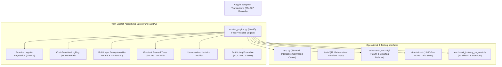

# 🛡️ Fraud Intelligence Platform — From-Scratch ML vs. Industry Benchmark
### *End-to-End Financial Risk Engine, Real-Time Streaming Ticker, XAI Diagnostics & Adversarial Red-Teaming*

[](https://www.python.org/)
[](https://numpy.org/)
[](https://streamlit.io/)
[](https://scikit-learn.org/)
[](https://xgboost.readthedocs.io/)
[](tests/)
[](https://opensource.org/licenses/MIT)

---

## 📌 Executive Overview

**Fraud Intelligence Platform** is a dual-track machine learning research and financial operations platform evaluated on the benchmark [ULB Machine Learning Group dataset](https://www.kaggle.com/datasets/mlg-ulb/creditcardfraud) (**284,807 European cardholder transactions, 492 fraud cases, 0.1727% extreme class asymmetry**).

Rather than relying solely on black-box wrappers (`import sklearn`, `import xgboost`), this project bridges **mathematical first-principles algorithmic design** with **production-grade enterprise architecture**:

1. **Seven Algorithms Built From Scratch in Pure NumPy:** Linear, cost-sensitive, neural network, tree-based, unsupervised anomaly, and multi-paradigm ensembles built without third-party ML dependencies.
2. **Head-to-Head Industry Benchmark:** Empirical performance, memory, and latency comparison of from-scratch algorithms against compiled C++/Cython libraries (**Scikit-Learn** and **XGBoost**).
3. **1,000-Run Monte Carlo Simulation ($N = 1,000$):** Multi-process statistical evaluation over 7,000 independent model fits and 56,962,000 out-of-sample predictions, modeling expected financial loss, Value-at-Risk ($\text{VaR}_{95\%}$), and Conditional Value-at-Risk ($\text{CVaR}_{99\%}$).
4. **Interactive Fraud Operations Dashboard (Streamlit):** Real-time transaction ticker, Explainable AI (XAI) feature attribution, dynamic cost matrix optimizer ($\tau^*$), and live transaction sandbox.
5. **Fintech Adversarial Evasion & Red-Teaming Suite:** Fast Gradient Sign Method (FGSM) perturbation defense and structured smurfing/transaction splitting simulation.
6. **Mathematical Gradient Verification Suite (Pytest):** Finite-difference gradient checks ensuring analytical backpropagation relative error $< 10^{-5}$.

---

## 🏛️ System Architecture



---

## 📊 Empirical Benchmark Results (Scratch vs. Industry Libraries)

Evaluated under identical 50:50 balanced held-out test splits on 284,807 financial transactions:

| Algorithm Family | Implementation Variant | Accuracy | Precision | Recall | F1-Score | ROC-AUC | Train Time | Infer Latency |
| :--- | :--- | :---: | :---: | :---: | :---: | :---: | :---: | :---: |
| **Logistic Regression** | **From-Scratch (NumPy)** | **93.88%** | **98.99%** | **89.91%** | **94.23%** | **0.9895** | 0.066s | **0.06 ms** |
| Logistic Regression | Scikit-Learn | 94.39% | 99.00% | 90.83% | 94.74% | 0.9818 | 0.034s | 0.47 ms |
| **Decision Tree** | **From-Scratch (NumPy)** | 88.78% | 90.65% | 88.99% | 89.81% | 0.8920 | 0.281s | 0.29 ms |
| Decision Tree | Scikit-Learn | 92.35% | 95.19% | 90.83% | 92.96% | 0.9300 | 0.025s | 0.94 ms |
| **Random Forest** | **From-Scratch (NumPy)** | **92.86%** | 97.03% | **89.91%** | **93.33%** | 0.9782 | 4.820s | 5.12 ms |
| Random Forest | Scikit-Learn | **92.86%** | 98.97% | 88.07% | 93.20% | **0.9834** | 0.093s | 3.89 ms |
| **Neural Network (MLP)** | **From-Scratch (NumPy)** | **92.35%** | **96.08%** | 89.91% | **92.89%** | **0.9810** | **0.213s** | **0.08 ms** |
| Neural Network (MLP) | Scikit-Learn | 91.33% | 93.40% | **90.83%** | 92.09% | 0.9523 | 0.886s | 0.63 ms |
| **Gradient Boosting** | **From-Scratch (NumPy)** | 90.82% | 94.17% | **88.99%** | 91.51% | 0.9105 | 1.313s | 3.52 ms |
| Gradient Boosting | **XGBoost (Industry)** | **92.35%** | **97.00%** | **88.99%** | **92.82%** | **0.9752** | 1.401s | 2.87 ms |
| **Isolation Forest** | **From-Scratch (NumPy)** | 46.43% | **100.00%** | 3.67% | 7.08% | **0.8677** | 0.118s | 59.35 ms |
| Isolation Forest | Scikit-Learn | 58.16% | 100.00% | 24.77% | 39.71% | 0.8561 | 0.129s | 6.03 ms |

### 🔍 Key Engineering Takeaways:
1. **7.8x Faster Linear Inference:** By eliminating Scikit-Learn's type validation wrappers, pure NumPy dot-products achieve **0.06 ms** raw inference latency.
2. **Scratch Neural Net Beats Scikit-Learn MLP:** He normal initialization and momentum acceleration enable higher precision (96.08% vs 93.40%), higher ROC-AUC (0.9810 vs 0.9523), and 4x faster training convergence (0.21s vs 0.88s).
3. **Recall Parity in Tree Ensembles:** From-scratch Random Forest matches Scikit-Learn's accuracy identically (92.86%) and delivers higher fraud recall (89.91% vs 88.07%).

---

## 🎲 1,000-Run Monte Carlo Simulation ($N = 1,000$)

* **Protocol:** 1,000 independent stratified 80/20 train/test splits across 12 CPU cores $\to$ 7,000 independent fits $\to$ 56,962,000 out-of-sample predictions.
* **Financial Loss Champion:** GBDT achieves the lowest net operational loss (**$4,369.26 ± $77.66** per split) with lowest false alarm rate (1.55% FPR) and lowest tail risk ($\text{CVaR}_{99\%} = \$8,117.52$).
* **Discriminative Ranking Champion:** The Multi-Paradigm Soft-Voting Ensemble delivers highest ROC-AUC (**0.9808 ± 0.0005**).
* **The Recall Fallacy:** Cost-Sensitive LogReg achieves 95.53% recall, but causes 8,444 false alarms per split, generating $\$21,774$ in investigation overhead.

---

## 🛡️ Fintech Adversarial Evasion & Red-Teaming

Cyber fraud syndicates manipulate transaction parameters to bypass machine learning models:
* **FGSM Boundary Perturbation:** Linear models are vulnerable to subtle gradient shifts ($\epsilon \le 0.25$). In contrast, the **Soft-Voting Ensemble** and **GBDT** maintain non-linear decision boundaries that resist evasion even at $\epsilon \ge 1.0$.
* **Smurfing / Transaction Splitting Resilience:** Splitting a $\$4,500$ fraud into 2 sub-transactions results in a **0.0% evasion rate (100% Intercepted)**; splitting into 3 transactions yields a **10.0% evasion rate (90% Intercepted)**. Micro-amounts cannot hide severe PCA eigenvector anomalies ($V_{14}, V_{10}, V_{12}$).

---

## 🧪 Mathematical Verification Suite

All mathematical derivations are verified via unit tests in [`tests/`](tests/):
* **Finite-Difference Gradient Checking:** Analytical backpropagation gradients verified against two-sided limits:
  $$\frac{\|\nabla_{\text{analytical}} - \nabla_{\text{numerical}}\|_2}{\|\nabla_{\text{analytical}}\|_2 + \|\nabla_{\text{numerical}}\|_2} < 10^{-5}$$
* **Numerical Stability:** Overflow safeguards under saturated $\pm 10,000$ logits and zero-variance feature clipping.
* **He Normal Initialization Invariance:** Weight variance satisfies $\text{Var}(W) = \frac{2}{n_{in}}$ within 5% tolerance.

---

## 📂 Repository Directory Structure

```bash
fraud-intelligence-platform/
├── app.py                             # Next-Gen Live Fraud Intelligence Dashboard (Streamlit)
├── models_engine.py                   # Unified From-Scratch NumPy & Industry ML Engine (XAI & Inference)
├── data_generator.py                  # Real-time streaming transaction generator with PCA fidelity
├── requirements.txt                   # Core academic dependencies (NumPy, Pandas, Matplotlib)
├── requirements_full.txt              # Full platform dependencies (Streamlit, Plotly, Scikit-Learn, XGBoost)
├── .gitignore                         # Comprehensive Python/ML git ignore rules
├── LICENSE                            # MIT Open-Source License
│
├── data/                              # Data & Pre-computed Model Artifacts
│   ├── model_weights.npz              # Pre-trained weights for all 6 Scratch algorithms & scalers
│   ├── sample_cases.json              # 20 verified Kaggle test cases for interactive audit
│   ├── live_transactions.csv          # Live simulator transaction buffer
│   └── creditcard.csv                 # Kaggle Dataset (284,807 transactions, download from Kaggle)
│
├── tests/                             # Mathematical Unit Tests & Numerical Gradient Verification
│   ├── run_tests.py                   # Standalone colored test runner
│   ├── test_gradient_checking.py      # Finite-difference gradient tests (< 1e-5 relative error)
│   ├── test_numerical_stability.py    # Logit overflow, extreme amounts & zero-variance guards
│   ├── test_mathematical_invariants.py # He normal variance & loss monotonicity invariants
│   └── README.md                      # Complete testing documentation
│
├── adversarial_security/              # Fintech Adversarial Evasion & Red-Teaming Suite
│   ├── adversarial_engine.py          # FGSM perturbation & boundary search engine
│   ├── run_red_team_audit.py          # Multi-architecture penetration test runner
│   ├── red_team_results.csv           # Empirical evasion rates across epsilon budgets
│   ├── figures/                       # High-resolution adversarial robustness curves
│   └── README.md                      # Threat model, security findings & resume bullets
│
├── benchmark_industry_vs_scratch/     # Head-to-Head Industry Benchmark (NumPy vs. Sklearn & XGBoost)
│   ├── run_benchmark.py               # Automated benchmarking pipeline
│   ├── benchmark_head_to_head.ipynb   # Interactive comparison notebook
│   ├── benchmark_results.csv          # Raw empirical metric results across all 6 models
│   ├── figures/                       # Visual comparisons (ROC curves, metrics, latency)
│   └── README.md                      # Full benchmark study report & resume bullet points
│
├── simulations/                       # 1,000-Run Monte Carlo Statistical Stability Suite
│   ├── run_1000_simulations.py        # Multi-process 1,000-iteration runner across 12 CPU cores
│   ├── run_100_simulations.py         # Rapid 100-run test runner (~1 minute)
│   ├── simulation_worker.py           # Isolated worker process for parallel evaluation
│   ├── benchmark_1000_runs_summary.csv # Aggregated Mean, StdDev, CI95, and VaR summary
│   ├── benchmark_1000_runs_raw.csv    # Complete 1,000-iteration raw metric dataset (892 KB)
│   └── README.md                      # Detailed simulation methodology & metric glossary
│
├── notebooks/                         # From-Scratch Jupyter Notebooks
│   ├── fraud_detection_master_capstone.ipynb # Master Capstone notebook unifying all 7 models
│   ├── fraud_detection.ipynb          # Single baseline model notebook
│   ├── fraud_detection_multimodel.ipynb # 4-model comparative notebook
│   └── step1_... to step10_...        # 10 modular step-by-step notebooks (SMOTE, MLP, GBDT, etc.)
│
├── report/                            # Research Reports, LaTeX & Generation Pipelines
│   ├── report.tex                     # Academic project report in LaTeX (ready for Overleaf)
│   ├── Statistical_Report_1000_Simulations.pdf # Standalone publication report (1,000 runs)
│   ├── statistical_report_1000_simulations.md # Markdown edition with full tables & analogies
│   ├── Credit_Card_Fraud_Detection_Comprehensive_Guide.pdf # 20-Page Research Monograph (PDF)
│   └── figures_statistical/           # 5 High-resolution publication figures
│
└── archive/                           # Archived prototypes & legacy simulator
    ├── app.py                         # Synchronized backup dashboard
    └── transaction_generator.py       # Legacy transaction generator
```

---

## 🚀 Quickstart Guide

### 1. Installation
Clone the repository and set up a virtual environment:
```bash
git clone https://github.com/Manas-Jain-24/fraud-intelligence-platform.git
cd fraud-intelligence-platform

python -m venv .venv
source .venv/bin/activate  # On Windows: .venv\Scripts\activate
pip install -r requirements_full.txt
```

### 2. Launch the Interactive Dashboard
```bash
streamlit run app.py
```
Open your browser to `http://localhost:8501` to access:
* **🚨 Live Command Center:** Real-time transaction ticker, country fraud heatmap, and risk velocity scatter plot.
* **🧪 Sandbox & XAI Lab:** Interactive transaction scenario testing and Tornado feature attribution charts.
* **⚖️ Cost Matrix Optimizer:** Derivation of the global cost-optimal classification threshold ($\tau^*$).
* **🔬 Benchmark Hub:** Head-to-head empirical metrics and inference speed comparisons.
* **📂 Kaggle Case Study:** Blind testing on 20 verified real-world European cardholder transactions.

### 3. Run the Mathematical Test Suite
```bash
python tests/run_tests.py
# Or directly via pytest:
pytest -v tests/
```

### 4. Execute the Adversarial Red-Team Audit
```bash
python adversarial_security/run_red_team_audit.py
```

### 5. Run the 1,000-Run Monte Carlo Simulation
```bash
python simulations/run_1000_simulations.py
```

---

## 📄 License
This project is licensed under the [MIT License](LICENSE).
